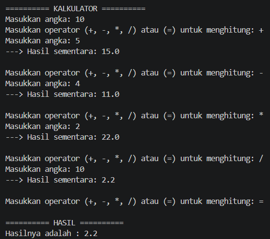

### PROGRAM KALKULATOR ANGKA :snake:

---
Program **kalkulator sederhana** berbasis teks (*Command Line Interface*) yang dibuat menggunakan bahasa pemrograman Python. Program ini mendukung perhitungan berantai (terus menghitung dari hasil sebelumnya) hingga pengguna memilih untuk mengakhirinya.

---
#### :gear: Cara Menjalankan Program
Pastikan komputer Anda sudah terinstal Python 3.8 atau yang lebih baru (dikembangkan menggunakan Python 3.12). Untuk menjalankan program ini, silahkan ikuti panduan berikut ini:

1. **Unduh kode program:**
```bash
git clone https://github.com/ardipuji/kalkulator-angka.git
```

2. **Masuk ke folder proyek:**
```bash
cd kalkulator-angka
```

3. **Jalankan program:**
```bash
python kalkulator.py
```
atau
```bash
py kalkulator.py
```

---
#### :camera_flash: Preview



---
#### :man_technologist: Author
Dikembangkan oleh **Ardi**

- :email: **Email:** [hardipuji19@email.com](mailto:hardipuji19@email.com)
- :link: **GitHub:** [@ardipuji](https://github.com/ardipuji)

---
*Terbuka untuk saran, masukan, maupun peluang kolaborasi!*
